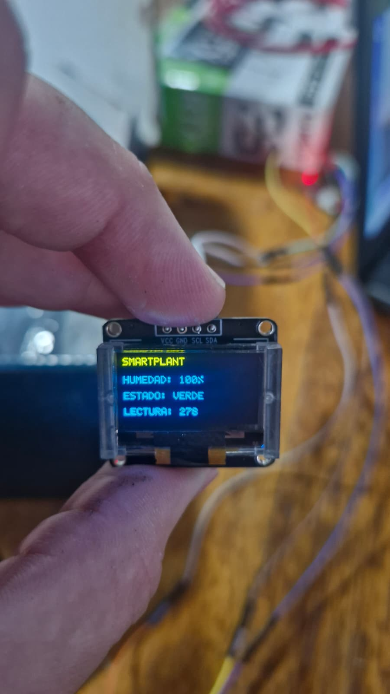
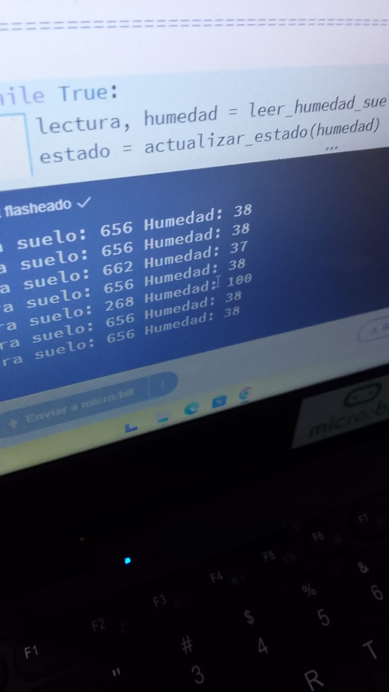

# Informe de Avance 3: Octubre 202x

## 7/10/202x
- Por problemas climáticos no pudimos venir a clase por lo cual el avance quedo estancado en la clase anterior

## 14/10/202x
  -El dia de hoy estuvimos buscando soluciones en el codigo para que funcione el DHT11.

  - Nos encontramos con el problema de que el DHT11 no tiene el tiempo de respuesta que necesita para ejecutar el codigo ya que la             microbit pone una capa al leer el codigo.
  -La solucion que encontramos fue usar una microbit aparte solo para el DHT11. La funcion de esa microbit sera tomar los datos del           DHT11 y enviarlos por radio hacia la otra microbit.
 
## 21/10/2026
- Retomamos lo que que hicimos la clase pasa.
- Presentamos un nuevo problema el serial de la microbit por alguna razon no se leia en PC, lo cual nos impedia colocarle el nuevo codigo a las microbit.
- El profesor nos presto y Agustin se llevo dos microbit del profesor, para testear por nuestra cuenta y por fuera del horario de la clase nuevo codigo para darle las funcionalidades necesarias para el proyecto.

## 28/10/2026
- Retomamos lo que habíamos hecho la clase pasada. Reestructuramos el proyecto.
- Decidimos :
  - eliminar la segunda microbit con el sensor DHT-11, dadas las repetidas fallas al leer los datos durante persistentes clases.
  - Quedamos con micro bit, pantalla oled y el sensor capacitante
  - Conectarle la alimentación por pilas AAA x2 hace que se corrompan los datos de la pantalla. Por lo cual también eliminamos la portabilidad que nos da las pilas AAA. Nos quedamos con la alimentación por micro usb.
Tareas completadas
    - Logramos terminar el proyecto y poder avanzar con las pruebas.
      
  Problemas y soluciones.
 - El problema principal que encontramos fue que el sensor DHT11 no estaba funcionando como deberia por lo cual la solucion que tomamos luego de varios intentos fue no utilizar ese sensor.
 - Tambien no podes utilizar dos pilas AAA ya que el codigo se corrompe y la pantalla oled no muestra los datos por lo cual por ahora este prototipo va a estar conectado a una pc para que sea el voltaje adecuado 

    - 

    - 
  

## Nota
En este enlace encontrarás un [ejemplo como debe completarse el informe de avance](avance_ejemplo.md).
